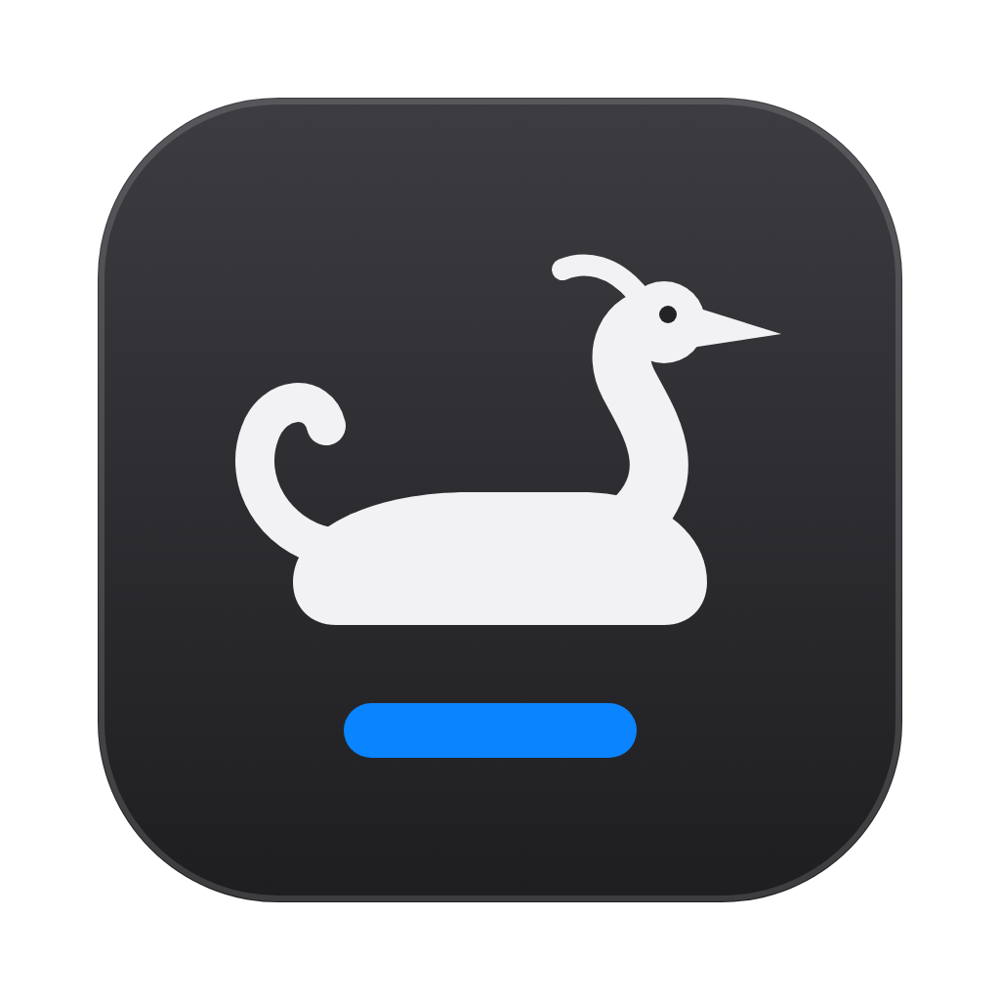
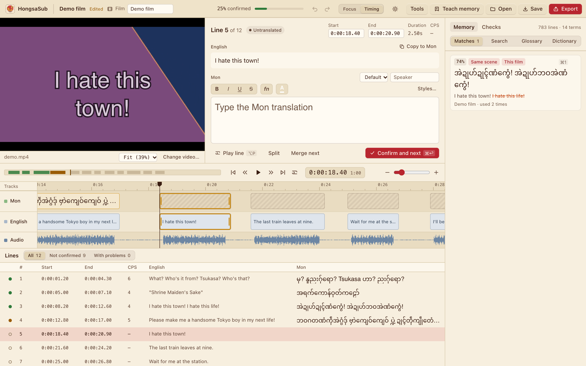

<div align="center">



# HongsaSub

**The subtitle editor that remembers your Mon.**

---

Translate film subtitles from English into Mon (ဘာသာမန်) beside the playing video.
Every line you confirm goes into a translation memory, so the same or a similar line is never translated twice, in this film or the next one.

[](https://tauri.app)
[](#install)
[](#license)
[](https://github.com/TaoMonLae/hongsasub/releases/latest)
[](https://en.wikipedia.org/wiki/Mon_language)

[Download for macOS](https://github.com/TaoMonLae/hongsasub/releases/latest/download/HongsaSub-mac.dmg) · [Download for Windows](https://github.com/TaoMonLae/hongsasub/releases/latest/download/HongsaSub-windows-x64-setup.exe) · [Download for Linux](https://github.com/TaoMonLae/hongsasub/releases/latest/download/HongsaSub-linux-amd64.deb) · [Watch the video](https://youtu.be/ZdCRqhHLn78) · [Get started](#get-started) · [Features](#features) · [Keyboard](#keyboard) · [Contributing](CONTRIBUTING.md) · [Security](SECURITY.md)

<br>

<picture>
  <source media="(prefers-color-scheme: dark)" srcset="docs/screenshot-dark.png">
  
</picture>

</div>

## Why HongsaSub

Subtitle editors like Aegisub know about video, waveforms and timing, but forget every line once the file is closed. Translation tools remember everything, but have no video, no timeline and no idea what a subtitle is. HongsaSub joins the two for one job: **turning English subtitles into well-timed Mon subtitles, faster with every film.**

## Features

### Translate with memory
- **Translation memory.** Every confirmed line is stored with its neighbours and film. Matches come back with a score, a word-by-word diff, and "same scene" or "this film" hints. Press `⌘1`–`⌘9` to use one.
- **Fill from memory.** Fill every untranslated line that memory already knows as a draft. You choose how close a match must be (exact, 95%+ or 85%+), and one undo removes them all.
- **Teach memory from finished work.** Pair an English subtitle with your finished Mon one by timing, review doubtful pairs (merged lines, numbers that differ, lines left untranslated) and add them to memory.
- **Glossary and dictionary.** Keep agreed terms for names and places. Look up any Mon or English word in the built-in [MonDict](https://github.com/Barnista/MonDictDB) dictionary of 26,000 words (`⌘D`).
- **AI assistant (optional).** Ask ChatGPT, Claude or Gemini for a Mon translation of the current line (`⌘J`), or draft every untranslated line at once. It reads your memory, glossary and the lines around each line, and everything it writes arrives as a draft for you to check. Use a ChatGPT plan through OpenAI's [Codex](https://developers.openai.com/codex) app (choose any model your plan offers, and how hard it thinks), a free Gemini key from [Google AI Studio](https://aistudio.google.com/apikey) (no card needed), an OpenAI, Claude or paid Gemini API key, or any other service with an OpenAI-compatible API (OpenRouter, DeepSeek, Mistral, Groq, xAI, Together AI, or models on your own computer through Ollama or LM Studio); set it up in **Settings → Assistant**. On a free Gemini key, Google may use what you send to improve its products. Keys are kept in your system's keychain. Claude Pro and Max plans and Google AI Pro and Ultra plans can't be used, because Anthropic and Google don't allow other apps to use them.

### Check before you ship
- **Quality checks.** Reading speed, line length, rows per line, too short or too long on screen, overlaps, small gaps, broken tags, stray spaces, numbers that differ from the English, and glossary terms translated inconsistently. Most problems have a one-click fix.
- **Mon spell-check.** Mon text is split into syllables and matched against the dictionary, so typos such as a doubled final consonant are underlined as you type. Words you use often in your memory are learned automatically.
- **Session pace.** See lines per hour and an estimate of the time left.

### Time it to the picture
- **Video preview** with styled captions, and zoom from 25% to 200%. MKV and HEVC films are repackaged or converted once with ffmpeg, then cached.
- **Waveform timeline.** Drag lines and their edges. They snap to other lines, the playhead, and where speech starts and stops.
- **Shift timings** for subtitles timed to a different release, plus **split** and **merge** lines.

### Edit like a pro
- Bold, italic, underline, strikeout, font and colour, written as ASS tags or SRT HTML tags.
- A **Styles manager** with a reusable style library.
- **Find and replace** that never touches tags or line breaks.
- Undo and redo for every text, timing and style change.
- **Back up and restore** your memory, glossary, spelling words and styles as one file, from Settings → Memory.
- **Paper and Dark themes.** Warm cream Paper takes its colours from the logo, and graphite Dark is for night work. The app follows macOS, or you can pick one from the toolbar.
- Resizable panes, and a **Focus** layout for long translation sessions.
- Opens `.srt`, `.ass` and `.ssa`. Saves `.hongsa` projects and exports ASS or SRT.

## Get started

### Download for macOS

[Download HongsaSub 1.2](https://github.com/TaoMonLae/hongsasub/releases/latest/download/HongsaSub-mac.dmg) for macOS 11 or later, on Apple Silicon or Intel. It is signed and notarized by Apple. Open the `.dmg` and drag HongsaSub into Applications. FFmpeg for video and waveforms is included.

### Download for Windows

[Download HongsaSub 1.2 for Windows](https://github.com/TaoMonLae/hongsasub/releases/latest/download/HongsaSub-windows-x64-setup.exe) for Windows 10 and 11, 64-bit, and run the installer. It isn't code-signed yet, so Windows may say it protected your PC: choose **More info**, then **Run anyway**. FFmpeg for video and waveforms is included.

### Download for Linux

[Download HongsaSub 1.2 for Linux](https://github.com/TaoMonLae/hongsasub/releases/latest/download/HongsaSub-linux-amd64.deb) for 64-bit Ubuntu 22.04 and Debian 12 or later, and install it with:

```bash
sudo apt install ./HongsaSub-linux-amd64.deb
```

This also installs FFmpeg from your system's packages. On other Linux systems, build it from source as below. Every version is on the [releases page](https://github.com/TaoMonLae/hongsasub/releases).

### Build from source

Requirements:

- [Rust](https://rustup.rs) (stable)
- [Node.js](https://nodejs.org) 20+ and [pnpm](https://pnpm.io)
- [ffmpeg](https://ffmpeg.org) (includes ffprobe) for video playback and waveforms. Without it you can still translate and export. Release builds bundle it: `pnpm ffmpeg:mac` then `pnpm release:mac` on a Mac, or `scripts/ffmpeg-windows.ps1` then `pnpm release:windows` on Windows.
- The [Tauri 2 prerequisites](https://tauri.app/start/prerequisites/) for your system

#### Run from source

```bash
git clone https://github.com/TaoMonLae/hongsasub.git
cd hongsasub
pnpm install
pnpm tauri dev
```

#### Build the app

```bash
pnpm tauri build
```

The installer is written to `target/release/bundle/`.

#### Run the tests

```bash
cargo test --workspace
```

## Keyboard

| Keys | Action |
| --- | --- |
| `⌘ Enter` | Confirm the line and go to the next |
| `⌘1` – `⌘9` | Use a memory match |
| `⌥↑` `⌥↓` | Move between lines |
| `⌥P` | Play the current line |
| `Space` | Play or pause |
| `⌘Z` `⌘⇧Z` | Undo and redo |
| `⌘B` `⌘I` `⌘U` | Bold, italic, underline |
| `⌘D` | Look up the selected word |
| `⌘G` | Add the selection to the glossary |
| `⌘J` | Ask the assistant for a translation |
| `⌘F` | Search the memory |
| `⌘⇧H` | Find and replace |
| `⌘⇧F` | Switch between the Focus and Timing layouts |
| `⌘S` `⌘O` `⌘E` | Save, open, export |

On Windows and Linux, use `Ctrl` for `⌘` and `Alt` for `⌥`.

## How it is built

```
hongsasub/
├── crates/hongsasub-core   Rust: SRT/ASS parsing and writing, projects, translation memory (SQLite),
│                           pairing, dictionary, Mon spell-check
├── src-tauri               Rust: Tauri app, commands, ffmpeg media pipeline, local media server,
│                           translation assistant (Codex, OpenAI, Claude, Gemini and OpenAI-compatible APIs)
├── src                     React + TypeScript interface
└── brand                   Logo artwork
```

Your translation memory, glossary, style library and personal word list stay on your computer, in the app's data folder. Nothing is sent anywhere unless you turn on the assistant and ask it for a translation; then only the lines you ask about, the lines around them, matching memory lines and glossary terms go to the service you chose. To keep them safe or move them to another computer, open **Settings → Memory** and choose **Back up…**; **Restore…** adds a backup to the memory without removing anything.

## Status

HongsaSub **1.2** adds an optional AI assistant for drafting Mon translations. 1.1 added memory backups and bundled FFmpeg. It is used for real film work. Mac, Windows and Linux downloads are on the [releases page](https://github.com/TaoMonLae/hongsasub/releases). Keep backups of your `.hongsa` projects, and back up your memory from Settings → Memory.

## Contributing

Bug reports, Mon language corrections and pull requests are welcome. See [CONTRIBUTING.md](CONTRIBUTING.md).

## Credits

- The Mon dictionary comes from [MonDictDB](https://github.com/Barnista/MonDictDB) by Barnista, MIT License.
- Built with [Tauri](https://tauri.app), [React](https://react.dev) and [SQLite](https://sqlite.org).
- The Mac and Windows downloads include [FFmpeg](https://ffmpeg.org), LGPL 2.1. Its licence and source details are in the app's `ffmpeg-licence` folder.

## License

HongsaSub is licensed under either of

- [Apache License, Version 2.0](LICENSE-APACHE)
- [MIT License](LICENSE-MIT)

at your option.

Unless you explicitly state otherwise, any contribution you intentionally submit for inclusion in this work, as defined in the Apache-2.0 license, shall be dual-licensed as above, without any additional terms or conditions.
